RIO GRANDE DO SUL, BRASIL · PROJETISTA MECÂNICO → DESENVOLVEDOR FULL STACK

 

### CAPÍTULO 01 · IDENTIDADE

Sou **Davi dos Santos Cardozo**, desenvolvedor Full Stack em transição de carreira, com mais de 10 anos de bagagem técnica na indústria como projetista mecânico. Hoje essa bagagem está a serviço de software: a mesma leitura cuidadosa de tolerância, estrutura e consequência — aplicada a sistemas em vez de peças.

Graduado em **Análise e Desenvolvimento de Sistemas**, pós-graduando em **Ciência de Dados e Big Data Analytics**, e atualmente cursando o **Bootcamp Full Stack +praTi**. Em busca de uma oportunidade como **Desenvolvedor Full Stack Estágio/Júnior**.

### CAPÍTULO 02 · ORIGEM

Passei mais de uma década desenhando peças mecânicas: tolerâncias milimétricas, montagens que precisam encaixar na primeira tentativa, documentação técnica que outra pessoa vai depender para não errar. Engenharia, nesse sentido, nunca foi sobre criatividade livre — era sobre precisão dentro de restrições.

A migração para desenvolvimento de software não foi um recomeço, foi uma troca de material: trocar aço e desenho técnico por tipos, contratos de API e banco de dados. As perguntas continuam as mesmas — *o que pode falhar aqui? o que essa peça precisa garantir para quem monta em cima dela?* — só que agora a peça é um endpoint, uma migration, uma trava de concorrência.

### CAPÍTULO 03 · ENGINEERING MINDSET

Como eu construo:

- **Planejamento antes de código.** Escopo e prioridades são discutidos e cortados deliberadamente antes da primeira linha — inclusive abrindo mão de complexidade desnecessária quando ela não resolve um problema real do projeto.
- **IA como par de desenvolvimento, não como atalho.** Em projetos como o *Verzel Pass* e o *Elite Events Platform*, cada trecho gerado é revisado, testado manualmente e só então commitado — nenhuma função é considerada pronta sem validação própria.
- **Decisões técnicas documentadas.** Trade-offs de arquitetura (o que foi escolhido, o que foi descartado e por quê) ficam registrados junto do código, não apenas na minha cabeça.
- **Segurança como etapa, não como reflexo.** O *Verzel Pass* passou por auditoria estática própria cobrindo isolamento de dados, RBAC, IDOR, gestão de segredos e XSS — com relatório técnico versionado no repositório.

### CAPÍTULO 04 · TECHNOLOGY

**Languages**
 
    

**Frontend**
 
   

**Backend**
 
  

**Database**
 
  

**Tools & Infra**
 
   

**Learning**
 
 

### CAPÍTULO 05 · SELECTED WORKS

Evolução do desafio técnico <a href="https://github.com/DaviSCardozo/elite-events-platform"><b>Elite Events Platform</b></a> — construída após a entrega, como exercício de design de interface e blindagem de segurança. · <a href="https://verzel-pass-redesign.vercel.app">Demo ↗</a>

  

<a href="https://finance-control-eight-pi.vercel.app">Demo ↗</a> · <a href="https://finance-control-backend-jhdf.onrender.com/swagger-ui.html">API Docs ↗</a>

  

  

### CAPÍTULO 06 · ACTIVITY

### CAPÍTULO 07 · CONNECTION

<a href="mailto:dev.davicardozo@gmail.com">dev.davicardozo@gmail.com</a> ·
<a href="https://linkedin.com/in/davi-cardozo-2b1046288">LinkedIn</a> ·
<a href="https://daviscardozo.github.io/landing-page-davi/">Landing Page</a>

Persistência • Visão • Determinação

