<!--
  Perfil de Davi Cardozo — "do projeto mecânico ao software".
  Todos os gráficos são SVG autorais gerados por scripts/build.py (sem serviços externos).
  O painel de atividade é atualizado por .github/workflows/activity.yml.
-->

<picture>
  <source media="(max-width: 640px)" srcset="assets/banners/hero-mobile.svg">
  <source media="(prefers-reduced-motion: reduce)" srcset="assets/banners/hero-static.svg">
  
</picture>

  


Sou **Davi dos Santos Cardozo**, desenvolvedor Full Stack. Passei mais de dez anos na indústria como projetista mecânico e hoje aplico a mesma leitura de tolerância, estrutura e consequência a sistemas, em vez de peças.

**Formação** · Análise e Desenvolvimento de Sistemas (graduado) · pós em Ciência de Dados e Big Data Analytics (em curso) · Bootcamp Full Stack +praTi (em curso) 
**Busco** · uma oportunidade como Desenvolvedor Full Stack, Estágio ou Júnior 
**Base** · Rio Grande do Sul, Brasil

 


Por mais de uma década desenhei peças mecânicas: tolerâncias milimétricas, montagens que precisam encaixar na primeira tentativa, documentação da qual outra pessoa depende para não errar. Engenharia nunca foi criatividade livre; era precisão dentro de restrições.

Migrar para software não foi um recomeço, foi uma troca de material. As perguntas continuam as mesmas (*o que pode falhar aqui? o que esta peça precisa garantir para quem monta em cima dela?*), só que agora a peça é um endpoint, uma migration, uma trava de concorrência.

<picture>
  <source media="(max-width: 640px)" srcset="assets/graphics/conversion-mobile.svg">
  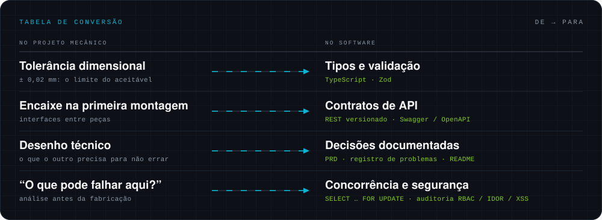
</picture>

  


- **Planejamento antes de código.** Escopo e prioridades são discutidos e cortados antes da primeira linha, inclusive abrindo mão de complexidade que não resolve um problema real do projeto.
- **IA como par de desenvolvimento, não como atalho.** No *Verzel Pass* e no *Elite Events Platform*, cada trecho gerado é revisado, testado manualmente e só então commitado.
- **Decisões técnicas documentadas.** O que foi escolhido, o que foi descartado e por quê fica registrado junto do código, não só na minha cabeça.
- **Segurança como etapa, não como reflexo.** O *Verzel Pass* passou por uma auditoria estática própria (isolamento de dados, RBAC, IDOR, gestão de segredos e XSS), com relatório versionado no repositório.

 


<picture>
  <source media="(max-width: 640px)" srcset="assets/graphics/bom-mobile.svg">
  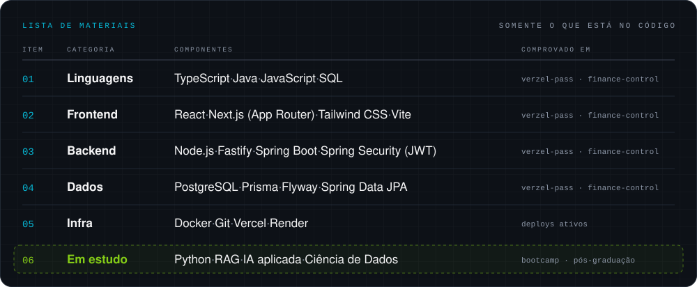
</picture>

Uma lista de materiais só lista o que está na montagem: cada item acima aparece no código dos projetos abaixo. A última linha é estudo, não experiência.

  


**O problema** · Duas pessoas não podem comprar o mesmo assento, e a portaria precisa saber em segundos se um ingresso é válido. 
**O que construí** · Projeto individual, do PRD ao deploy: compra dentro de transação com trava de linha (`SELECT … FOR UPDATE`), três papéis com RBAC (organizador, cliente e portaria), validação por QR Code com a câmera e uma auditoria de segurança própria com relatório em PDF. 
**Ver** · [Repositório](https://github.com/DaviSCardozo/verzel-pass-redesign) · [Demo](https://verzel-pass-redesign.vercel.app) · [Relatório de segurança](https://github.com/DaviSCardozo/verzel-pass-redesign/blob/main/docs/security-audit/relatorio-auditoria-seguranca.pdf) · [PRD](https://github.com/DaviSCardozo/verzel-pass-redesign/blob/main/docs/PRD.md)

 

**O problema** · O saldo de hoje não diz se o mês fecha no positivo. 
**O que construí** · Projeto individual: API em Spring Boot com Spring Security + JWT e migrations Flyway; interface em React com tabela estilo planilha (TanStack Table), gráficos (Recharts) e exportação para CSV. O saldo projetado soma o que já foi confirmado ao que ainda está pendente no mês. 
**Ver** · [Repositório](https://github.com/DaviSCardozo/finance-control) · [Demo](https://finance-control-eight-pi.vercel.app) · [API (Swagger)](https://finance-control-backend-jhdf.onrender.com/swagger-ui.html) a API hiberna quando ociosa e pode levar alguns segundos para responder

 

<a href="https://github.com/DaviSCardozo/elite-events-platform">
  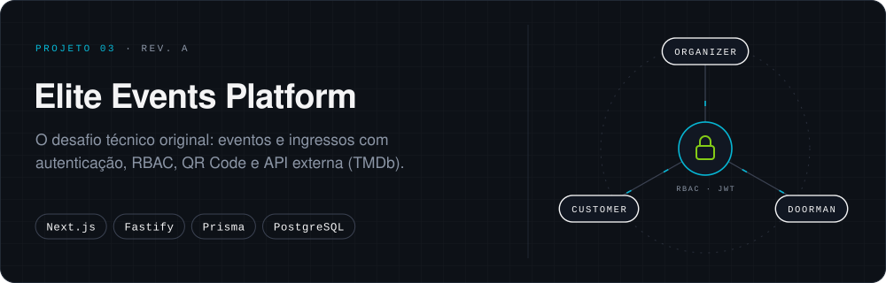
</a>

**O contexto** · A revisão A: a entrega original de um desafio técnico, que depois evoluiu para o Verzel Pass. 
**Por que está aqui** · Comparar as duas revisões mostra o que mudou entre "entregue no prazo" e "revisado com calma": design system, blindagem de segurança e documentação. 
**Ver** · [Repositório](https://github.com/DaviSCardozo/elite-events-platform)

No laboratório: <a href="https://github.com/DaviSCardozo/daily-dev-studies">daily-dev-studies</a>, meu diário de estudos, e <a href="https://github.com/DaviSCardozo/portfolio-ia">portfolio-ia</a>, o índice dos estudos de IA aplicada.

  


<picture>
  <source media="(max-width: 640px)" srcset="assets/graphics/terminal-mobile.svg">
  
</picture>

  


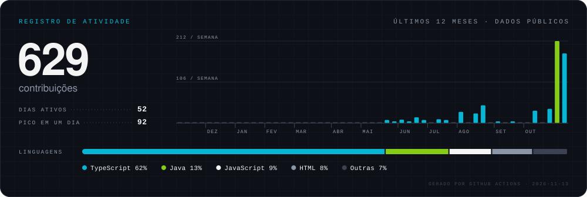

  


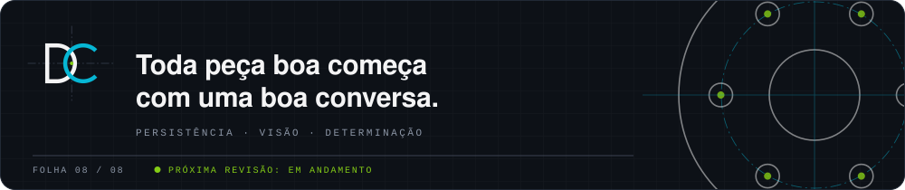

  
  &nbsp;
  
  &nbsp;
  

